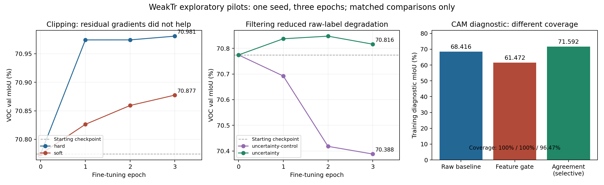

# WeakTr weakness pilots: results and interpretation

Reviewed 2026-11-16. Evidence: the user-delivered `weaktr-experiments.zip` and `experiment-report.txt`, with code at `a62033a7d69a5789ec9e278ae1c1b51393a2c383`. All experiments use seed 504 on a Tesla T4, PyTorch 1.13.1+cu117. These are frozen diagnostics and three-epoch fine-tuning pilots starting from the completed reproduction, rather than new full reproductions.

**The strongest positive finding is that agreement filtering reduces the damage from noisy raw CAM targets. It improves its matched control by 0.428 mIoU points, but does not beat the strongest original-label fine-tuning arm. Residual clipping and cosine affinity gating did not improve their respective controls.**

## Matched segmentation comparisons

Every arm starts at exactly 70.774198% on all 1,449 VOC validation images. The procedure is single-scale sliding-window inference, window/stride 480/320, one decoder output, FP32, without CRF. All four arms complete three epochs, 2,646 batches per epoch, and use the final planned epoch rather than selecting the best validation epoch.

| Arm | Supervision / intervention | Start | Epoch 1 | Epoch 2 | Epoch 3 | Change from start |
| --- | --- | ---: | ---: | ---: | ---: | ---: |
| Hard clipping | Original CRF pseudo-labels, original hard clipping | 70.774 | 70.974 | 70.974 | 70.981 | +0.207 |
| Residual clipping | Same labels, gradient multiplier 0.1 above clipping threshold | 70.774 | 70.826 | 70.859 | 70.877 | +0.103 |
| Uncertainty control | Regenerated raw CAM labels, no agreement filtering | 70.774 | 70.692 | 70.418 | 70.388 | -0.386 |
| Uncertainty filtering | Same raw CAM predictions; inconsistent pixels ignored | 70.774 | 70.837 | 70.847 | 70.816 | +0.042 |

Matched treatment effects at epoch 3:

- Residual minus hard clipping: **-0.103336 pp**.
- Uncertainty filtering minus uncertainty control: **+0.427842 pp**.

Paired validation-image bootstrap (2,000 resamples, seed 504) gives 95% percentile intervals of **[-0.209, -0.009] pp** for residual minus hard clipping and **[+0.147, +0.802] pp** for uncertainty minus its control. These intervals describe image resampling for fixed trained models; they do not establish robustness across training seeds.

The uncertainty pair normalizes training loss by valid pixels; the clipping pair uses the original all-pixel mean. The clipping pair uses existing CRF pseudo-labels, whereas the uncertainty pair uses newly generated raw CAM labels. Consequently, the uncertainty pair isolates the implemented filtering intervention within raw-label fine-tuning. Comparing uncertainty against hard clipping does not isolate filtering applied to the original CRF targets.

Hard clipping has the highest observed final pilot score (70.981%). Uncertainty is 0.165 pp below it. The +0.428 pp matched effect is primarily prevention of a -0.386 pp decline, rather than a large improvement over the starting checkpoint.

The completed reproduction remains **72.865% under multiscale/two-decoder/CRF evaluation**. It must not be replaced by or directly subtracted from these pilot numbers. No final multiscale/CRF pilot scores have been measured.



## 1. Pseudo-label reliability: the strongest supported improvement direction

The frozen Phase-1 model predicts labels using four views: scales 1.0 and 1.2, each with and without horizontal flipping. A pixel is retained only when at least three of four view predictions agree with the aggregate prediction. The remaining pixels become ignore label 255. The retained class labels are unchanged; this intervention removes supervision rather than correcting labels.

| Diagnostic split | Raw CAM mIoU | Filtered selective mIoU | Valid-GT pixel coverage | Raw pixel accuracy | Retained-pixel accuracy |
| --- | ---: | ---: | ---: | ---: | ---: |
| Development, 100 train images | 62.410 | 66.747 | 96.214% | 88.276% | 90.227% |
| Held diagnostic split, 200 train images | 68.416 | 71.592 | 96.473% | 90.812% | 92.292% |

The conditional quantity is `P(prediction correct | pixel retained)`, not accuracy on all original pixels. On the held diagnostic split, 3.527% of valid-GT pixels are removed. Their accuracy is only **50.339%**, versus **92.292%** among retained pixels. On the development split, removed-pixel accuracy is **38.685%**. These derived values come from subtracting the filtered confusion matrix from the baseline matrix; they directly establish that disagreement concentrates errors in these sampled training images.

This supports the concern that a single hard pseudo-label is treated as reliable even where predictions vary under benign transformations. It does not show that agreement is calibrated probability: the views share one model and can agree on an incorrect prediction.

The training experiment provides the more important downstream check: the filtered model evaluates on **all validation pixels** and still gains 0.428 pp over its raw-label control. That improvement cannot be explained merely by excluding difficult validation pixels.

Coverage is uneven. On the held diagnostic split, only **75.732% of TV/monitor pixels** are retained, compared with **97.299% of background pixels**. Filtering therefore risks systematically removing supervision for specific classes. It improves TV/monitor validation IoU by 1.477 pp relative to its raw-label control, so this risk should not be confused with an observed TV/monitor decline in this run. The largest treatment gains are boat (+2.848), aeroplane (+2.350), TV/monitor (+1.477), horse (+1.290), chair (+1.282), and bicycle (+1.190). Dining table declines by 2.131 pp; the effect is not uniform.

**Defensible conclusion:** disagreement is a useful signal for reducing noisy raw pseudo-label supervision, with a modest positive downstream pilot effect. It has not yet improved the original CRF-label training pipeline.

**Next candidate, not a measured result:** apply agreement to the original CRF pseudo-label pipeline and compare against the same CRF-label control with identical loss normalization. Consider weighting ambiguous pixels rather than deleting them, with class-level coverage monitoring. Disagreement is not evidence that a retained label should be replaced by another class.

## 2. Hard clipping discards correct supervision, but a uniform residual gradient did not help

With the threshold treated as detached, the original loss and its above-threshold derivative are:

`L_hard(l) = min(l, tau)`; `d L_hard / d l = 0` when `l > tau`.

The treatment is:

`L_residual(l) = min(l, tau) + alpha * max(l - tau, 0)`, with `alpha = 0.1`.

Its derivative is 0.1 above the threshold. It restores learning from difficult correct targets, but also restores learning from incorrect targets. The frozen diagnostic examines the final Phase-2 model on 64 fixed, resized training images; all 16 batches activate clipping.

| Diagnostic | Measurement |
| --- | ---: |
| Correct pseudo-label pixels rejected | 713,653 / 12,498,742 = **5.710%** |
| Incorrect pseudo-label pixels rejected | 896,658 / 1,437,786 = **62.364%** |
| Accuracy among rejected labels | **44.318%** |
| Accuracy among retained labels | **95.610%** |

Both sides matter: the rejection set contains substantial correct supervision, and it is strongly enriched for incorrect labels. The diagnostic supports a precision/coverage tradeoff, rather than a conclusion that clipping is generally harmful.

Correct-label rejection varies sharply by true class: bottle 99.940% (5,001/5,004), dining table 85.951% (55,669/64,768), chair 37.778% (79,284/209,867), versus background 4.124% (414,252/10,044,480). These are pixel counts in a small fixed sample, not estimates from independent examples or a whole training trajectory. GT is used only to diagnose correctness after prediction and clipping decisions.

The treatment finishes at 70.877 versus 70.981 for hard clipping. It is below the control at all three measured epochs. Thus the proposed **uniform 0.1 residual gradient is unsupported as an improvement in this pilot**. A plausible explanation is that restoring gradients to the noisy portion of the rejection set offsets the benefit of recovering correct supervision; this is an interpretation, not an identified causal decomposition.

**Next candidate, not a measured result:** restore gradients only where another reliability signal supports the pseudo-label, for example `alpha_i = 0.1 * agreement_i`, with a matched hard-clipping control. Preserve a safeguard for classes whose difficult correct labels have low agreement. A frozen final-model diagnostic does not establish how clipping behaved during early original training.

## 3. Propagation sensitivity: the simple cosine gate failed

The proposed gate multiplies attention by nonnegative patch-feature cosine similarity and then rescales each row to preserve its original total mass:

`A'_ij = A_ij * max(cos(f_i, f_j), 0) * sum_k(A_ik) / sum_k(A_ik * max(cos(f_i, f_k), 0))`.

Empty weighted rows fall back to the original attention. The checkpoint, foreground tags, views, and CAM threshold are fixed between the baseline and gated arms.

| Split | Baseline raw CAM mIoU | Gated raw CAM mIoU | Difference |
| --- | ---: | ---: | ---: |
| Development | 62.410 | 61.266 | **-1.144 pp** |
| Held diagnostic split | 68.416 | 61.472 | **-6.944 pp** |

Both methods predict every valid-GT pixel, so these are complete-mask comparisons on the diagnostic images. On the held split, the largest class losses are TV/monitor (-48.957 pp), bird (-35.135), cat (-25.712), car (-22.412), and sheep (-20.075). Some classes improve, including horse (+11.507), but the average is substantially worse.

Preserving row mass does not preserve which patch receives class evidence. Classification-trained patch similarity need not coincide with same-object semantic affinity. Multiplicative gating can suppress useful links between visually different object parts or emphasize similar-looking background regions. These mechanisms are plausible explanations for the measured degradation; the current experiment does not distinguish them.

**Defensible conclusion:** this frozen cosine gate is not an improvement. The result establishes sensitivity to the choice of affinity, not proof that the original adaptive attention fusion is intrinsically defective or that all feature-guided propagation fails.

**Next candidate, not a measured result:** a small residual blend `(1-lambda)A + lambda A'`, or a feature affinity learned with appropriate supervision, may be less destructive. These require new evidence; the current gate should not be presented as a successful modification.

## Limits and presentation guidance

- One training seed, one checkpoint, and three fine-tuning epochs do not establish robustness across full retraining runs. Paired image-bootstrap intervals in the receipt describe validation-image resampling for these fixed models, not training-seed uncertainty.
- The two CAM splits are disjoint diagnostic subsets of the original training images. The label "holdout" does not mean the model never saw those images.
- The boundary-band diagnostic covers only **4,206 of 33,536,350 valid-GT pixels (0.01254%)** on the held CAM split because transitions into ignore regions are excluded. It is not standard Boundary IoU and cannot establish a general boundary-quality improvement.
- Full 10,582-image label generation deliberately reads no GT. Its empty score dictionary is expected, rather than a missing evaluation. GT was used for the frozen diagnostic subsets and normal validation.
- Ignoring labels also changes batch-derived clipping thresholds because ignored cross-entropy pixels are zero. The uncertainty comparison measures the implemented filtering intervention together with its interaction with clipping, not an isolated uncertainty-calibration mechanism.
- Fresh optimizer / constant learning rate fine-tuning is a separate pilot protocol. The original 60/100-epoch reproduction and its checkpoint selection remain distinct.

For a presentation, lead with the positive uncertainty result, then explain the clipping tradeoff and its unsuccessful simple remedy, and finish with the negative cosine-gating result. A useful investigation includes rejected hypotheses. Do not describe all three modifications as validated improvements or claim the original paper score has been exceeded.

## Evidence and reproducibility

All **38,806 payload SHA256s** in the 38,807-member ZIP pass. The standalone report matches its archived copy. All four final validation confusion matrices were independently reproduced from saved prediction PNGs and local VOC GT. Both complete 10,582-label generated collections match the fingerprints recorded by their training arms. Archive SHA256: `4ff68a81c91263b3913782823b0dae40fa00562139adcf1bc4fec012de5a4c3a` (1,636,771,734 bytes).

Recorded core stages span **5h 13m 11s**, including approximately **30m 13s** for full label generation and about 69 minutes per training arm. This excludes initial environment/data setup and final notebook/export overhead, and is not a GPU billing total.

The verification receipt contains per-epoch metrics, class deltas, source identities, stage timings, archive/payload hashes, and fixed-model image-bootstrap intervals: [EXPERIMENT_REVIEW_RECEIPT.json](EXPERIMENT_REVIEW_RECEIPT.json).

Run the read-only CPU analysis from the repository root with local original VOC ground truth and the delivered ZIP/report available:

```powershell
python docs/results/review_experiments.py
```

This hashes every archived payload, checks completed stages and source identities, verifies both full generated-label fingerprints against training identities, recomputes all four final validation confusion matrices from saved PNGs and local GT, and generates the receipt and figure. No GPU job is launched.

The repository CPU suite also passes all 89 tests after this review (`PYTHONPATH=artifacts/pytest74`, plugin autoload disabled, normal filesystem permissions): `python -m pytest tests -q --tb=short -p no:cacheprovider --basetemp artifacts/pytest-experiment-review-verified`. No model/training implementation changes were made for the analysis.
