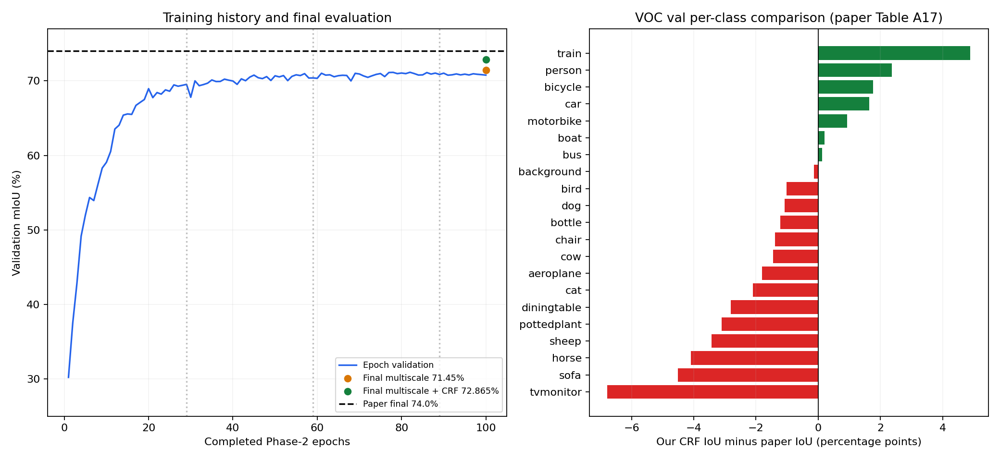

# Final WeakTr DeiT-S VOC 2012 reproduction review

Reviewed 2026-11-15 from user-provided `final-report.txt`, `final-summary.txt` and `weaktr-resume (1).zip`.

Both training schedules and final validation evaluations are complete. Final post-CRF validation mIoU is **72.8654278306%**, **1.1345721694 percentage points below the 74.0% paper target**. This completes the experiment; it does not establish a numerical match to the paper.

## Evidence and progress

- SHA256 verification passed for all 10,646 manifest payloads in the 1,702,064,091-byte archive. Both supplied reports match their archived versions.
- Locally loaded full snapshots confirm Phase 1 epoch 59 (60 completed) and Phase 2 epoch 99 (100 completed), with optimizer, scheduler and RNG state present. Logs contain exactly epochs 0-59 and 0-99 respectively, without gaps or duplicate rows.
- All 10,582 pseudo-label PNG names match the augmented training list. Phase-2 run records start at epochs 0, 29, 59 and 89 and retain the same pseudo-label fingerprint, `f0ba69493d0734f1f7b0a69516a751d27382c6250330d5e9891bf094bcec0876`.
- Final evaluation and CRF records are `command_completed`; both identify the final checkpoint SHA256 `891e0cbcbcabdd695d9a56ef7bce9830a8d1b3e3a77752795cfff4ed0a4b67ba`. Score-file hashes match the summary and verified manifest.
- Validation covers 1,449 images and 21 classes including background. Final evaluation uses the epoch-100 latest checkpoint, multiscale inference, both decoder outputs with weight 0.8, and CRF.
- Final code commit: `0b7f75f11d15b0886532efaa36e70dfdd538d741`. Runtime: one Tesla T4, Python 3.10.22, PyTorch 1.13.1+cu117, CUDA 11.7; seed 504.

## Comparison with the paper

Reference: [WeakTr paper](https://arxiv.org/html/2304.01184v3), Table IV for train CAMs, Table VII for raw/CRF validation, Table II for the original DeiT-S target and Table A17 for validation per-class IoUs. Improved-backbone results and the 74.1% test-set score are separate experiments.

| Evaluation | Our mIoU (%) | Paper (%) | Our minus paper (pp) |
| --- | ---: | ---: | ---: |
| Phase-1 raw multiscale CAM, train 1,464 | 66.011 | 67.2 | -1.189 |
| Phase-1 saved CRF masks, train 1,464 | 68.189 | 69.4 | -1.211 |
| Final raw multiscale, val 1,449 | 71.450 | 73.0 | -1.550 |
| Final multiscale + CRF, val 1,449 | 72.865 | 74.0 | -1.135 |

The Phase-1 CRF row is a new local CPU measurement of the saved pseudo PNGs restricted to `voc12/train_id.txt`, using local `SegmentationClassAug` ground truth, ignoring 255 and aggregating a 21-class confusion matrix. It uses the same TP/(GT+prediction-TP) calculation as `evaluation.py`. Full counts are in `phase1-crf-train1464.json`. The earlier **62.780%** score used all **10,582 trainaug images** and must not be compared directly against the paper's 1,464-image train score. The matched-split measurement resolves that previous ambiguity.

CRF adds about 2.178 points to Phase-1 train CAM quality and 1.415 points to final validation quality. It improves every final class. Thus the measured shortfall is already visible before Phase 2, and final CRF is helping. This pattern suggests investigating Phase-1 quality first if further diagnosis is desired; it does not prove the cause of the final gap.

## Training behavior and elapsed time

The best per-epoch validation mIoU was 71.15% at zero-based epoch 81 (human epoch 82). The last checkpoint achieved 70.77% under the per-epoch evaluation procedure. The final raw multiscale procedure reaches 71.45%, then CRF reaches 72.865%. These are different evaluation procedures; the higher final scores are not additional training epochs. No multiscale/CRF evaluation of the best-epoch checkpoint is claimed.

The last five per-epoch validation scores were 70.79, 70.95, 70.88, 70.83 and 70.77%. The late schedule has plateaued rather than showing evidence that more epochs are needed. Extending beyond 100 epochs would change the intended reproduction schedule.

The final 11-epoch stage took 14,348.13 seconds (3h 59m); final multiscale evaluation 3,365.03 seconds (56m 5s), and CRF 364.00 seconds (6m 4s). Combined final training/evaluation was about 5h 1m, excluding setup/export. These are stage elapsed times, not total GPU billing or the full experiment's wall time.

## Per-class analysis

Seven of 21 classes exceed the paper's rounded per-class IoUs. Largest gains are train (+4.89 pp), person (+2.36), bicycle (+1.77) and car (+1.64). Largest deficits are TV/monitor (-6.78), sofa (-4.51), horse (-4.09), sheep (-3.43) and potted plant (-3.11). The weakest absolute classes are chair (34.11%), sofa (39.49%), bicycle (46.17%), dining table (47.99%) and TV/monitor (49.42%). A low absolute score and a large gap to the paper are different observations: chair is also difficult in the paper, whereas TV/monitor has the largest reproduction deficit.

| Class | Raw (%) | CRF (%) | Paper CRF (%) | CRF minus paper (pp) |
| --- | ---: | ---: | ---: | ---: |
| background | 91.67 | 92.26 | 92.4 | -0.14 |
| aeroplane | 85.44 | 86.79 | 88.6 | -1.81 |
| bicycle | 45.00 | 46.17 | 44.4 | +1.77 |
| bird | 88.78 | 88.88 | 89.9 | -1.02 |
| boat | 68.49 | 71.20 | 71.0 | +0.20 |
| bottle | 76.72 | 79.58 | 80.8 | -1.22 |
| bus | 88.08 | 89.02 | 88.9 | +0.12 |
| car | 80.72 | 82.04 | 80.4 | +1.64 |
| cat | 89.35 | 91.01 | 93.1 | -2.09 |
| chair | 30.86 | 34.11 | 35.5 | -1.39 |
| cow | 81.75 | 83.75 | 85.2 | -1.45 |
| diningtable | 46.22 | 47.99 | 50.8 | -2.81 |
| dog | 83.33 | 84.43 | 85.5 | -1.07 |
| horse | 79.22 | 80.31 | 84.4 | -4.09 |
| motorbike | 78.39 | 79.33 | 78.4 | +0.93 |
| person | 78.04 | 79.26 | 76.9 | +2.36 |
| pottedplant | 54.69 | 56.89 | 60.0 | -3.11 |
| sheep | 86.17 | 86.77 | 90.2 | -3.43 |
| sofa | 38.80 | 39.49 | 44.0 | -4.51 |
| train | 80.73 | 81.49 | 76.6 | +4.89 |
| tvmonitor | 47.93 | 49.42 | 56.2 | -6.78 |

## Configuration/evaluation audit and limits

The final gap exceeds the plan's one-percentage-point audit threshold. Inspection confirms the recorded original DeiT-S backbone, seed 504, 60/100 schedules, batch sizes 64/4, generated pseudo-label targets, unchanged pseudo fingerprint across resumes, Phase-2 SGD/poly learning rate 1e-4 with encoder multiplier 0.1, clipping 1.2/120, resize/crop/window/stride 520/480/480/320, latest final checkpoint and documented multiscale/CRF route.

One known discrepancy remains between the official repository instructions and the paper appendix: Phase 1 followed `docs/Training.md` with supplied LR 6e-4 (scaled to 7.5e-5 at batch 64) and weight decay 0.03. Appendix A-A1 describes base LR 4e-4 (scaled to 5e-5) and weight decay 0.05. This was the recorded protocol choice, not an unexpected change during resume. Its contribution to the score gap has not been isolated. A single seed cannot establish statistical significance or attribute the shortfall to random variation. Successful resumed training does not replace a controlled GPU interrupted-versus-uninterrupted equivalence test. Author-checkpoint evaluation remains unperformed.

The ZIP contains no `seg_pred_ms/` final validation predictions. The remote reporting gate checked prediction-file coverage before export, but those PNGs cannot be independently checked or used to recompute final IoU from this ZIP. Preserve/download that folder from the saved Kaggle output for qualitative examples and an independent final mask-based check. The ZIP does contain all training pseudo masks and recoverable final model state. No VOC test-set server score is available.

No additional training is needed to finish this experiment. Remaining report work is to preserve final validation predictions, choose qualitative examples, and present the measured result and protocol differences. Additional GPU reference checks or retraining are separate follow-up work.

## Evidence files

- `final-summary.json`: copied measured summary.
- `final-archive-verification.json`: independent archive/checkpoint/report verification receipt.
- `phase1-crf-train1464.json`: independently recomputed matched-split CAM mask IoU and confusion matrix.
- `phase2-epoch-metrics.json`: all 100 logged epoch rows.
- `per-class-comparison.csv`: raw, CRF and paper per-class values and differences.
- `final-results.png`: training and per-class comparison figure.
