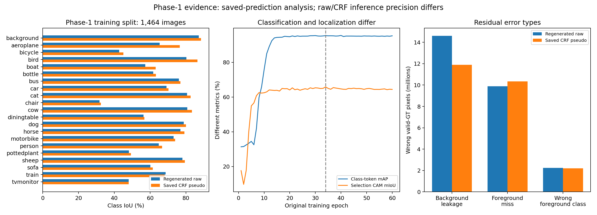
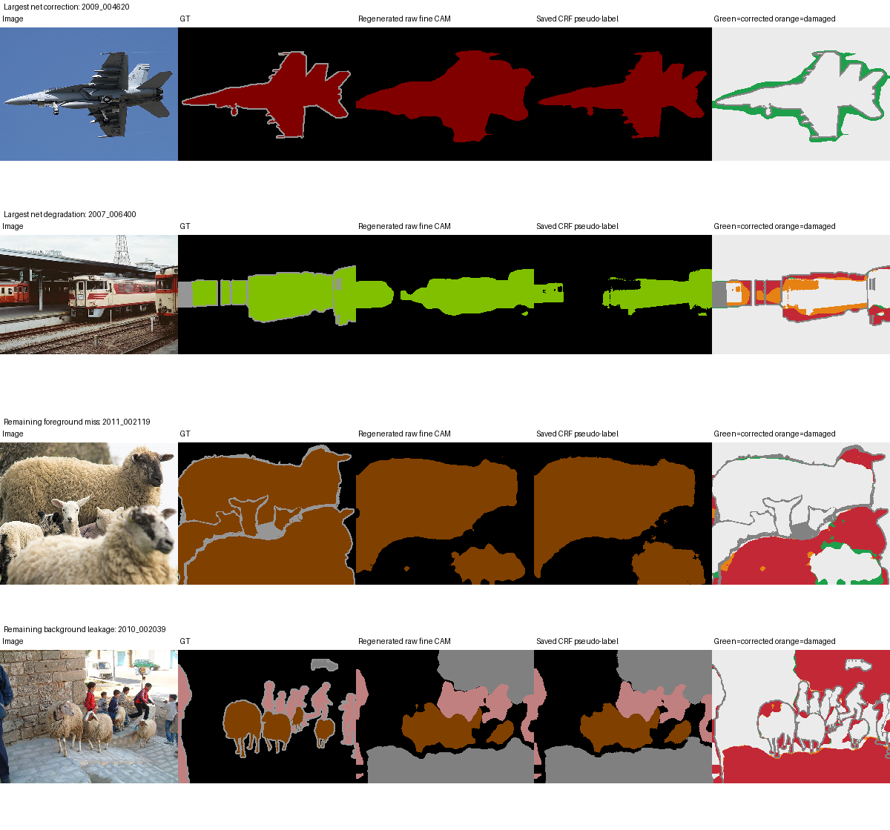

# Phase-1 CAM generation and pseudo-label quality

Reviewed 2026-11-16. The purpose is to distinguish training-time CAM refinement, subsequent pseudo-label post-processing, and errors that persist into Phase 2. Source code and saved results are the primary evidence; the [WeakTr paper](https://arxiv.org/html/2304.01184v3), Sections III-A, IV-C1 and Appendix A-D2, provide the authors' intended mechanism and reported comparisons.

## What our previous experiments covered

The cosine-gating and view-agreement CAM diagnostics were Phase-1 output analyses. Full 10,582-image uncertainty-label generation also uses the trained Phase-1 model. The hard/residual clipping and uncertainty fine-tuning arms evaluate Phase-2 training behavior. We have not retrained Phase 1 with a modified loss or measured coarse-versus-fine CAM component ablations from our checkpoint.

## Training-time refinement versus later post-processing

The implemented pipeline is:

`Phase-1 encoder + convolution -> coarse CAM -> learned AAF cross/patch attention -> fine CAM -> multi-view aggregation / background threshold -> CRF pseudo-labels -> Phase-2 training`.

AAF is trained together with Phase-1 classification. It is not a separately trained affinity model or a later random-walk training stage. The trained attention propagation is nevertheless evaluated again during CAM inference, and this reproduction does apply CRF before Phase 2. Therefore, "no separate learned refinement stage" is accurate; "no CAM post-processing" is not.

The paper's Table IV reports mean-sum attention at 61.7 mIoU, AAF at 67.2, and AAF+CRF at 69.4 on VOC train. Reported precision/recall rise from 75.0/77.9 to 77.0/83.8 with AAF. Those are the paper's component results, not ablations reproduced by us. They support the intended improvement in both suppression of irrelevant attention and object coverage.

Our original matched 1,464-image training results are raw fine CAM **66.011%** and saved CRF pseudo-labels **68.189%**, a **2.178 pp** gain. The raw CAM shortfall from the paper is already about 1.189 pp before Phase 2. This indicates that investigating Phase 1 is relevant, without identifying the cause of the reproduction gap.

## What the mathematics allows, and what the supervision cannot identify

For image x, let C be the nonnegative coarse CAM, Q be class-to-patch attention, and P be patch-to-patch attention. For class c, our code computes:

`F[c,i] = sum_j P[i,j] * Q[c,j] * C[c,j]`.

This can expand activation from discriminative parts to related parts when P is semantically useful. It can also suppress isolated high coarse-CAM activations when their surrounding patch connections carry little class evidence. Because the connections are global, expansion is not limited to immediate pixel neighbors. These are mechanisms, rather than measured coarse-to-fine gains from our checkpoint.

**Limitation 1: spatial correctness is underdetermined by pooled classification.** Fine-CAM training forms a class logit `s_c = mean_i F[c,i]` and applies image-level multilabel loss. Its derivative with respect to each fine-CAM location is `(sigmoid(s_c)-y_c)/(20*N)`, where N is the patch count. There is no direct pixel-specific target telling the model where the object should end. Maps `(2,0)` and `(1,1)` have the same pooled logit and classification loss despite different spatial coverage. Attention and image features provide inductive structure, but image-level labels cannot, by themselves, distinguish activation on an object from correlated context.

Consequences to investigate are object-to-background leakage, partial-object coverage, object-versus-co-occurring-object confusion, and disagreement across transformations. Better image classification is not evidence of better object extent.

**Limitation 2: head fusion is global within an image.** `AAF.py` produces 72 scalar weights for 12 layers x 6 heads. It applies the same weight for one head across every query/key pair, including all classes and spatial locations. For fixed input attention maps:

`A_hat(x) = (1/72) * sum_h w_h(x) * A_h(x)`.

The weights are image-dependent, but are neither class-specific nor patch-pair-specific. A head can be useful for one object region and misleading for another; downweighting it changes both. Nonnegative mixtures cannot freely rewrite individual edges or cancel an unwanted connection with a negative weight. This limits the expressiveness of the refinement, although it does not prove that this limitation dominates our errors. The failed frozen cosine gate demonstrates that adding a spatial similarity restriction can itself be destructive.

**Limitation 3: the fine-CAM loss has restricted gradient access.** `models.py` detaches the attention features, attention weights, and coarse CAM before the fine branch. Thus `L_fine` trains AAF, but does not backpropagate into the encoder or coarse convolution through that branch. The encoder still trains via class-token/coarse-CAM losses; it is not frozen during Phase 1. Training-time refinement is real, but an observed localization error in the fine branch cannot directly correct backbone features through its own loss.

There is an additional classification-surrogate caveat. Coarse CAM is passed through ReLU; fused attention is nonnegative; hence the pooled fine-CAM logits are nonnegative. Their sigmoid is at least 0.5, so absent classes cannot obtain confidently negative fine-CAM logits. A negative-class loss is bounded below by log(2). This is a property of this branch, not of the signed class-token/coarse classification heads. Inference masks absent classes using image-level tags and normalizes CAMs; the branch should not be interpreted as calibrated class or pixel probabilities.

## What the actual Phase-1 training history shows

| Measurement | Early / best | Final epoch |
| --- | ---: | ---: |
| Class-token mAP | 95.370% at epoch 34 | 95.268% |
| Coarse-head classification mAP | 95.064% at epoch 34 | 95.104% |
| Fine-head classification mAP | 89.236% at epoch 34 | 89.865% |
| Selection CAM mIoU | **65.837% at epoch 34** | **64.393%** |

Epochs are human-numbered here. The selection procedure searches its background threshold; it differs from final multiscale CAM evaluation, so its 65.837 must not be substituted for the final 66.011. Classification remains high while localization peaks earlier and then declines. The history shows that continuing classification training is not guaranteed to improve CAM quality; it does not isolate overfitting or the effect of AAF.

The recorded fine-CAM training loss ranges from **0.692996 to 0.693356**, close to log(2)=0.693147. At the same time, its classification mAP reaches 89.865%. Ranking and calibrated logit amplitude are different quantities. The near-constant loss does not establish that AAF never learns or that gradients vanish; confirming that would require gradient norms, logit distributions, or learned-head diagnostics that were not saved.

## What the pseudo-label phase can fix

The actual pseudo-label code first compares normalized foreground CAMs with constant background score 0.43 and takes argmax. `tool/imutils.py` then runs dense CRF for 10 iterations using spatial and RGB-sensitive pairwise terms.

This can remove isolated activation, smooth inconsistent labels, fill locally supported holes, and move a roughly correct semantic region toward image edges. It supplies high-resolution appearance information after the patch-grid CAM has been upsampled. These changes can improve extent and boundaries when the initial class evidence is already broadly right.

However, the unary is created from **hard argmax labels with fixed assigned-label probability 0.7**. A CAM that barely beats background and a strong CAM receive the same assigned-label unary confidence. The code has already discarded their soft evidence before CRF. The `gt_prob` argument is a CRF confidence parameter, not pixel ground truth.

CRF has no independent semantic classifier, object detector, or instance model. If a whole region has the wrong semantic label, or an object is missing from the CAM, RGB smoothness does not reliably reconstruct the correct class. Similar object/background appearance can propagate an existing mistake. CRF can also remove small correct regions. It cannot use classes excluded by the supplied image-level label set.

## New CPU measurements: what improves and what stays wrong

The analysis checks **21,164 unique PNG payload hashes**, covering regenerated raw fine-CAM predictions and original CRF pseudo-labels for all **10,582 images**. The selected Phase-1 checkpoint hash agrees between archives. The regenerated raw CAM is FP32, whereas the original pseudo-labels came from AMP CAM inference plus CRF. Thus this is a descriptive comparison between two saved outputs, not a fresh precision-matched CRF ablation. On the paper-comparable split, the regenerated raw score is 66.013%, only 0.002 pp from the originally measured 66.011%, but pixel-level precision differences are still possible.

| Split | Regenerated raw fine CAM mIoU | Saved CRF pseudo-label mIoU | Difference |
| --- | ---: | ---: | ---: |
| VOC train, 1,464 images | 66.013 | 68.189 | +2.176 pp |
| Additional augmented images, 9,118 | 60.788 | 61.917 | +1.129 pp |
| Full trainaug, 10,582 | 61.533 | 62.780 | +1.247 pp |
| Fixed diagnostic split, 200 | 68.416 | 70.794 | +2.378 pp |

The augmented and original training splits must remain separate in paper comparisons. A lower score on the augmented subset does not identify whether image difficulty, annotation properties or another factor causes the difference.

**The main observed benefit is precision and suppression of background leakage, rather than recovery of missing foreground.** On the 1,464-image split:

| Metric | Regenerated raw fine CAM | Saved CRF pseudo-label |
| --- | ---: | ---: |
| Macro precision, 21 classes | 76.266% | **79.626%** |
| Macro recall, 21 classes | **82.744%** | 82.047% |
| Background incorrectly labeled foreground | 14,612,623 pixels | **11,897,240 pixels** (-18.58%) |
| Foreground incorrectly labeled background | **9,889,134 pixels** | 10,341,899 pixels (+4.58%) |
| Confusion between foreground classes | 2,240,388 pixels | 2,197,445 pixels (-1.92%) |

CRF-associated changes are not uniformly good: **3,923,697** originally wrong pixels become correct, but **1,618,136** originally correct pixels become wrong. This is a net gain of 2,305,561 correct pixels. Only **14.672% of original wrong pixels are corrected**, while **85.328% remain wrong**. These are valid-GT pixel counts, not image-balanced averages or a claim that 85% of pixels are wrong. The saved labels are 90.152% pixel-accurate on this split. The correction rate is 12.312% on all trainaug images, so the main pattern persists on the larger collection.

The observed gain is concentrated near label-region edges. On the 200-image diagnostic split, error within eight pixels of a GT label change/image border decreases from **21.128% to 17.350%**, while farther-interior error decreases only from **5.933% to 5.607%**. This diagnostic includes margins against void labels when locating the region boundary, but evaluates only valid GT pixels. It is not standard Boundary IoU and does not infer the unknown ground truth inside void regions.

Class effects differ sharply:

| Class, train 1,464 | Raw IoU | Pseudo IoU | Interpretation |
| --- | ---: | ---: | --- |
| Aeroplane | 65.334 | 76.614 | Large improvement consistent with removal of broad surrounding activation |
| Bird | 80.253 | 86.416 | Precision rises 85.252 -> 94.329%; recall falls 93.191 -> 91.152% |
| Boat | 57.375 | 63.136 | Substantial improvement, but far from complete recovery |
| Chair | 31.748 | 32.454 | Still poor precision: 38.153%, recall 68.481% |
| Bicycle | 42.707 | 45.146 | Precision remains 49.571%, despite recall of 83.489% |
| TV/monitor | 48.098 | 48.010 | Essentially unchanged; weak decline in this comparison |
| Train | 68.677 | 68.168 | Some correct foreground is removed; average IoU declines |

The original fine CAM is already reasonably strong for several classes (raw IoU: cow 80.773, cat 80.609, bird 80.253). In contrast, chair, bicycle and plant/TV predictions show coverage-versus-precision problems. High recall with low precision points toward spatial over-activation, not simply failure to detect the class. Different classes need different fixes; raising or lowering one global background threshold trades off these errors.

Foreground class-confusion examples persist: dining-table GT pixels predicted as chair total **470,688** on the train split after CRF; person pixels predicted as sofa total **205,558**. These are directed confusion counts, not object counts. RGB/spatial smoothing barely reduces the aggregate foreground-class confusion, consistent with its lack of new semantic evidence.

Across **2,164 foreground image-class presences with >=64 valid GT pixels**, the count with zero correctly labeled pixels increases from **35 to 57**. This is a per-image/per-class measure rather than instance counting; it provides evidence that some weak semantic coverage is lost instead of recovered.



The examples below are selected by explicit extrema within the fixed 200-image diagnostic split, rather than presented as average cases. They show largest net correction, largest net degradation, largest remaining foreground miss, and largest remaining background leakage. The correction map uses green for newly correct pixels, orange for newly wrong pixels, red for pixels wrong in both outputs, light gray for correct in both, and darker gray for ignored GT.

- Aeroplane `2009_004620`: the broad raw activation is tightened toward the visible aircraft shape.
- Train `2007_006400`: large correct regions, including bright train parts, disappear in the saved pseudo-label.
- Sheep `2011_002119`: missing foreground parts/animals remain missing despite post-processing.
- People/sheep scene `2010_002039`: broad spatial over-activation persists around the actual objects.



## Controlled Phase-1 comparison that remains unmeasured

The most direct next diagnostic is a frozen-checkpoint comparison on the same 100 development / 200 diagnostic training images:

1. Coarse CAM alone: `relu(conv(features))`.
2. Cross-attention seed: `Q * coarse`.
3. Full learned fine CAM: `P * (Q * coarse)`.
4. The same fine CAM followed by CRF.
5. Optionally replace learned head fusion with mean-sum at inference while retaining the exact same checkpoint and views.

Use identical image tags, resize/flip views, numerical precision and map normalization. Report a fixed 0.43 background threshold, plus an explicitly separate threshold calibrated only on the development split if desired. Measure mIoU, per-class precision/recall, background leakage, missed foreground, confusion between foreground classes, and correction-versus-damage counts. Save fixed example IDs and include failures.

This needs only inference, not another 60-epoch run. The previous GPU CAM diagnostic took about one minute for 300 images, but this richer comparison and CRF are not yet timed. An inference-time mean-sum replacement measures the utility of learned weights at this checkpoint; it is not equivalent to retraining the baseline without AAF. The exported archives contain final fine-CAM labels, rather than coarse maps, soft float CAMs, or intermediate attention, so those missing component comparisons cannot be reconstructed from labels alone.

## Improvements suggested by these findings, not measured outcomes

- **Spatial consistency during Phase-1 training:** compare aligned fine CAMs under transformations, for example `L_eq = ||norm(F(Tx)) - T(norm(F(x)))||`, with confidence handling. This constrains spatial behavior beyond pooled image classification. Our agreement diagnostics motivate it, but enforcing consistent wrong predictions remains a risk. Respect the actual stop-gradient path when deciding which parameters this loss should train.
- **More selective fusion:** investigate class-conditioned or small residual adaptations of head fusion, rather than imposing a strong frozen cosine gate. The existing gate's negative result is a reason to require controlled inference diagnostics first.
- **Confidence-preserving pseudo-label refinement:** compare the current hard-label CRF unary with calibrated CAM-derived soft unaries, using exactly the same CAMs, CRF pairwise parameters and diagnostic splits. Better foreground/background calibration is part of this proposal; min-max normalized CAMs are not calibrated probabilities. The original soft CAMs must be regenerated before this test can be run.

All three suggestions are hypotheses. None is established as a successful modification by the current evidence.

## Evidence and reproduction

The offline analysis reads both archives and local VOC ground truth without launching any GPU work:

```powershell
python docs/results/review_phase1.py
```

It checks both copies of the selected Phase-1 checkpoint hash, verifies every raw/pseudo PNG read against its archive manifest, separates the 1,464-image train split from the additional augmented images, and records error/correction profiles and explicitly selected qualitative examples. See `PHASE1_CAM_ANALYSIS.json`, `phase1-cam-analysis.png`, and `phase1-cam-examples.png` beside this report. The regenerated FP32 raw predictions and original AMP/CRF pseudo-labels differ in inference precision, so their comparison is descriptive, not an exactly matched fresh CRF ablation. GT is used only for analysis; no training targets or archived artifacts are modified.

All 89 repository CPU tests also pass after this analysis: isolated pytest 7.4.4 on `PYTHONPATH`, plugin autoload disabled, normal filesystem permissions, `python -m pytest tests -q --tb=short -p no:cacheprovider --basetemp artifacts/pytest-phase1-review-verified`. No model/training implementation was changed. The CPU mask analysis and figure generation took approximately 493 seconds.
